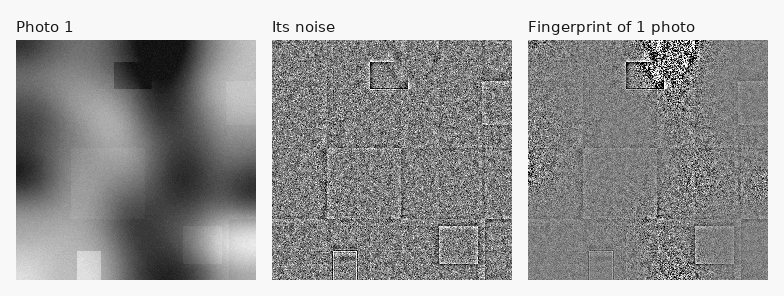
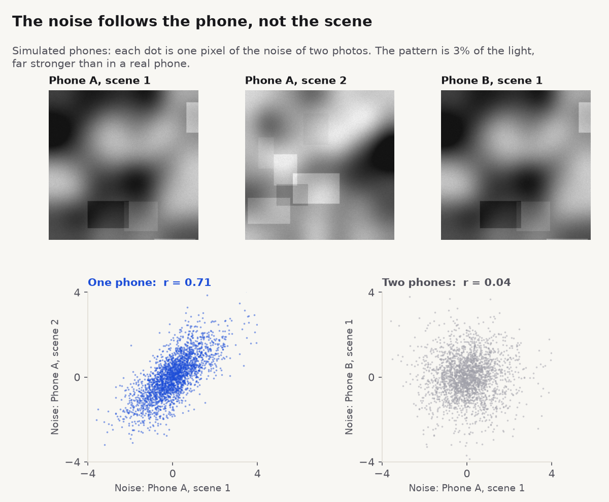
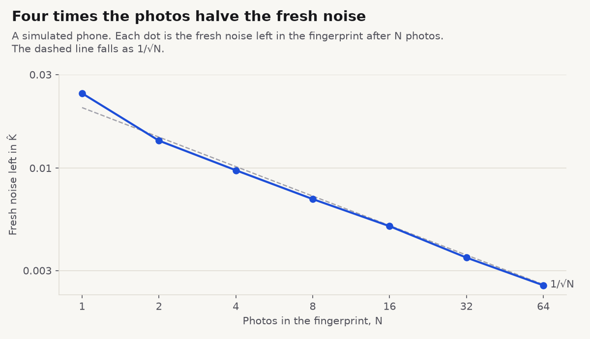
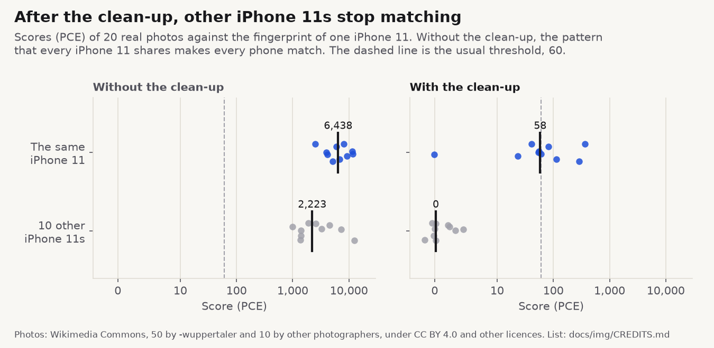
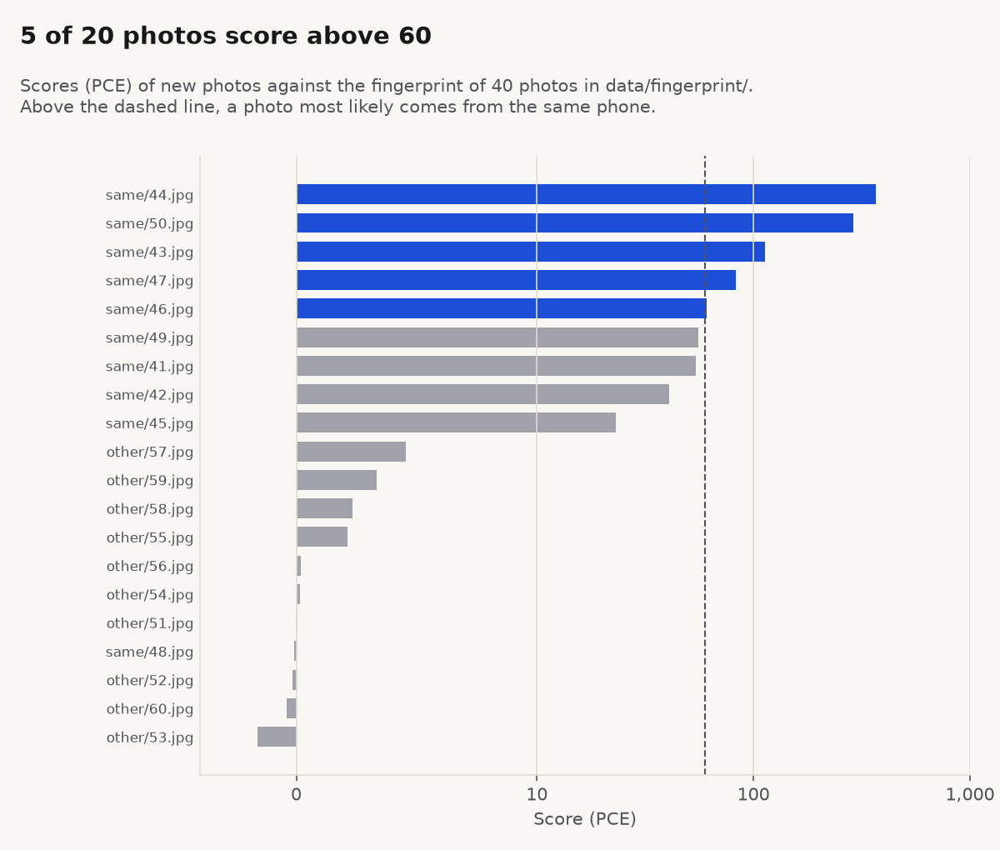
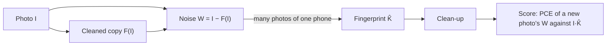

# Which iPhone took this photo?



Every camera sensor leaves a faint pattern of its own in its photos. This repo finds it in the photos of one phone,
and uses it to tell that phone apart from other phones of the same model. It is the code of my post
**[Every iPhone has a fingerprint. Can one photo give you away?](https://vhamolya.com/blog/which-iphone-took-this-photo/)**

_The animation is a simulated phone. Each new photo adds its noise to the average. The fixed pattern adds up, and the
fresh noise cancels. I planted the pattern in a ring so you can see it. A real fingerprint looks like plain static._

## Quick start

Install [uv](https://docs.astral.sh/uv/getting-started/installation/), then:

```bash
git clone https://github.com/vhamolya/iphone-fingerprint
cd iphone-fingerprint
uv run experiments/01_simulated_phones.py
```

The first `uv run` makes an environment with the locked versions of NumPy, SciPy, PyWavelets, Pillow and Matplotlib.
It needs Python 3.11 or newer, and uv downloads one if you have none. Each script prints its numbers and saves its
figure to `docs/img/`.

| Script | What it shows | Download |
|---|---|---|
| `experiments/01_simulated_phones.py` | The noise follows the phone, not the scene | none |
| `experiments/02_averaging.py` | Averaging the noise of N photos leaves 1/√N of the fresh noise | none |
| `experiments/03_real_iphones.py` | Real iPhone 11s: the same phone, other phones, and the clean-up | 199 MB |
| `experiments/04_your_photos.py` | A fingerprint from your own photos, and scores for new ones | your photos |
| `experiments/make_figures.py` | Rebuilds every figure and animation in this README | 199 MB |

## The experiments

### 1. The noise follows the phone



Two simulated phones take photos. Phone A takes two different scenes, and phone B takes the first scene too. I take
the noise out of each photo and compare the photos pixel by pixel. Phone A's two photos line up (r = 0.71), though
their scenes differ. Phone A and phone B do not (r = 0.04), even on the same scene.

The simulation exaggerates. Its pattern is 3% of the light. In real photos from one iPhone 11, two photos give
r = 0.0004 (experiment 3). One photo is not enough, so the method averages many.

### 2. From noise to fingerprint



A simulated phone takes 64 photos of new scenes. The average of their noise is the phone's fingerprint. The fixed part
adds up, and the fresh part cancels: it shrinks as N^-0.52, close to the 1/√N of pure averaging. So four times the
photos halve it. The script also makes the animation at the top of this page.

### 3. Real iPhone 11s



These are 60 full-size photos from Wikimedia Commons. 40 photos make the fingerprint of one iPhone 11. I score 10 more
photos from that phone and 10 photos from 10 other iPhone 11s against it.

```bash
uv run experiments/fetch_photos.py    # 60 photos, 199 MB, into data/
uv run experiments/03_real_iphones.py # one to a few minutes, and 2.5 GB of memory
```

| Score (PCE) against the fingerprint | Same phone | 10 other iPhone 11s |
|---|---|---|
| Without the clean-up | 2,508 to 11,685 | 985 to 12,454 |
| With the clean-up | −0.1 to 368, median 58 | −1.6 to 4.6 |

Without the clean-up, every iPhone 11 matches. All of them carry a pattern from the model's design and processing.
The clean-up removes it, and then other phones score between −2 and 5, as unrelated noise should. 9 of the 10 photos from the
same phone score above every other phone. Only 5 of them clear the usual threshold of 60, so one photo is a hint, not
proof. The script prints every score.

Single photos, compared pixel by pixel, give a median r of 0.0004 for one phone (45 pairs) and 0.0001 for two phones
(100 pairs). Those are the numbers in Part 1 of the post.

### 4. Your photos



Give the script a folder of photos from one phone, and new photos or folders to score. The figure above is its output
on the Commons photos:

```bash
uv run experiments/04_your_photos.py data/fingerprint data/same data/other --figure out/scores.png
```

Details are in the section [Your own photos](#your-own-photos).

## The method in brief



All of it lives in [`fingerprint.py`](fingerprint.py), in about 140 lines. Its defaults match the post.

The standard model (Chen and others, 2008) writes a photo $I$ as the scene $I^{(0)}$ seen through the pixel gains
$K$, plus fresh noise $\Theta$:

```math
I = I^{(0)} + I^{(0)} K + \Theta
```

**Noise.** Subtract the cleaned copy $F(I)$. What is left is the pattern times the brightness, plus everything else,
$\Xi$:

```math
W = I - F(I) \approx I K + \Xi
```

**Cleaned copy.** The filter of Lukáš, Fridrich and Goljan (2006) splits the photo into Daubechies (db4) wavelets over
four levels. For each detail $c$, it takes the mean of $c^2$ in windows of 3, 5, 7 and 9 pixels and keeps the
smallest. It estimates the scene's share $\hat\sigma^2$ and hands the rest to the noise, with $\sigma = 5$ on the 0
to 255 scale:

```math
\hat\sigma^2 = \max\left(0,\ \overline{c^2} - \sigma^2\right), \qquad c_\text{noise} = c \, \frac{\sigma^2}{\hat\sigma^2 + \sigma^2}
```

**Fingerprint.** Bright photos carry more of the pattern, so each photo counts by its brightness:

```math
\hat K = \frac{\sum_i W_i I_i}{\sum_i I_i^2}
```

**Clean-up.** Every phone of a model shares part of its fingerprint. The clean-up zero-means each of the four 2 × 2
sub-grids by rows and by columns. Then it flattens sharp peaks in the fingerprint's spectrum (above 3 times their
local mean).

**Score.** Correlate a new photo's noise $W$ with the pattern it should carry, $I \hat K$, shifted by every $s$.
$\rho(s)$ is the correlation at shift $s$. PCE compares the peak at $s = 0$ with the rest:

```math
\mathrm{PCE} = \frac{\rho(0)^2}{\frac{1}{|S|} \sum_{s \in S} \rho(s)^2}
```

$S$ holds every shift outside an 11 × 11 window around the peak. Unrelated noise scores near 1. A score above about
60 usually means the same phone (Goljan and others, 2009).

To try a better denoiser or score, add a new experiment that compares itself with these defaults.

## Your own photos

```bash
uv run experiments/04_your_photos.py ~/Pictures/my-phone ~/Pictures/new-photo.jpg
```

The first argument is a folder of photos from one phone. The rest are new photos, or folders of them. The script reads
your photos on your computer and sends them nowhere. It saves nothing unless you pass `--figure`, and `out/` is
ignored by git.

- Use originals straight from the phone: not cropped, resized or edited, and not sent through a messenger.
- Use 20 or more photos for the fingerprint. Bright, plain photos (sky, walls) hold more of the pattern than dark or
  busy ones.
- Use the main camera at 1×, so that every photo has the same size. The script leaves out photos of another size.
- Pillow reads JPEG and PNG. For HEIC, run `uv run --with pillow-heif experiments/04_your_photos.py ...`.

From the iPhone 16 on, Apple's processing adds a pattern that every phone of the model shares. The clean-up removes
only part of it, so a stranger's photo can still score above 60. Part 4 of the post covers it.

## Limits

- The repo reproduces the parts of the post that run on simulated phones and public photos. The line-ups of 28 iPhone
  models, the quality chart and the iPhone 16 results come from Flickr photos and from my own phone. I cannot share
  them, so they stay numbers in the post.
- Experiment 3 is one phone, 40 photos and 20 test photos. It shows the method. It does not measure its error rates.
- Simulated phones exaggerate. Their pattern is 1 to 3% of the light, and their scenes are made up in code.
- The post also used DRUNet, a neural denoiser, which gave the same results. It needs PyTorch, so the repo leaves it
  out.

## Credits, licence and citation

The 60 photos come from Wikimedia Commons: 50 by -wuppertaler (CC BY 4.0) and 10 by ten other photographers (CC BY
4.0, CC BY-SA 4.0, CC BY 2.0, CC BY 2.5 and CC0). [`docs/img/CREDITS.md`](docs/img/CREDITS.md) lists each photo with
its author, licence and link. The repo holds only their titles, in [`data/photos.tsv`](data/photos.tsv). The fetch
script downloads them and writes the credits from the Commons API.

The code is under the [MIT licence](LICENSE). Figures made from the Commons photos (experiments 3 and 4) keep the
photos' credit.

The method comes from these papers:

1. J. Lukáš, J. Fridrich and M. Goljan, "Digital camera identification from sensor pattern noise", *IEEE
   Transactions on Information Forensics and Security* 1(2), 2006.
2. M. Chen, J. Fridrich, M. Goljan and J. Lukáš, "Determining image origin and integrity using sensor noise", *IEEE
   Transactions on Information Forensics and Security* 3(1), 2008.
3. M. Goljan, J. Fridrich and T. Filler, "Large scale test of sensor fingerprint camera identification", *Proc. SPIE*
   7254, Media Forensics and Security, 2009.

To cite the post:

```bibtex
@misc{hamolia2026iphone,
  author = {Vladyslav Hamolia},
  title  = {Every iPhone has a fingerprint. Can one photo give you away?},
  year   = {2026},
  url    = {https://vhamolya.com/blog/which-iphone-took-this-photo/}
}
```
